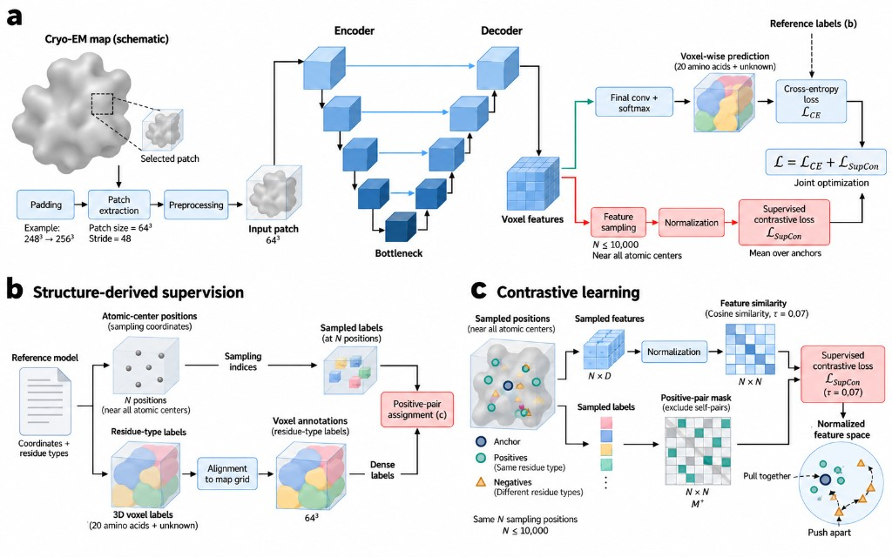

# EModelS (EModel-Seek)

**Sequence identification for structure-first cryo-EM discovery** via contrastive amino-acid typing.

EModelS extends [EModelX](https://github.com/biomed-AI/EModelX) with supervised contrastive learning for residue-type prediction, then identifies the protein sequence from the density map.

> One command: density map → Cα model → sequence identification.



## Install

```bash
conda env create -f environment.yml
conda activate EModelS
# from the repository root
export PYTHONPATH="$PWD:$PYTHONPATH"
```

Or: create a PyTorch CUDA environment yourself, then `pip install -r requirements.txt`.

### Network weights

| File | Role |
|------|------|
| `models/best_AA_model.ckpt` | Amino-acid typing (**EModelS**, val_acc=0.512) |
| `models/best_BB_model.ckpt` | Backbone atom prediction (EModelX) |
| `models/best_CA_model.ckpt` | Cα prediction (EModelX) |

All three checkpoints are in this repository with Git LFS. After clone, run `git lfs pull`.

### Sequence database

Prepare a local FASTA (paper: UniProtKB/TrEMBL). Pass it with `--fasta-db`.

## Quick start

```bash
python run.py \
  --map /path/to/emd_XXXXX.map.gz \
  --fasta-db /path/to/uniprot_trembl.fasta \
  --output-dir outputs/my_job \
  --device cuda
```

Outputs:

```
outputs/my_job/
  <name>_EModelS_ca_model.pdb   # sequence-free Cα model
  hmm_profiles/*.hmm            # forward (+ reverse) profiles
  hmm_hits/
    all_hits.csv
    best_hits.csv               # top-K ∪ best-per-chain
    best_hits_strict.csv        # E < --hit-evalue (default 1e-10)
    *.hhr                       # per-profile HMMER reports
```

### Useful flags (prefer parameters over multi-step scripts)

| Flag | Meaning |
|------|---------|
| `--skip-search` | Only build model + HMMs |
| `--skip-build` | Only search existing `hmm_profiles/` |
| `--no-write-reverse-hmm` | Forward profiles only |
| `--min-profile-len 30` | Skip short chains (default) |
| `--top-k 10` | Global top-K kept in `best_hits.csv` |
| `--hit-evalue 1e-10` | Strict filter for `best_hits_strict.csv` |
| `--E 10` | HMMER reporting E-value while collecting hits |
| `--F1/--F2/--F3` | HMMER filters |
| `--hmm-delta / --hmm-gamma` | Profile transition params (paper: 0.05 / 0.5) |
| `--aa-model` | Path to EModelS AA weights |
| `--cluster-eps`, `--ca-score-thrh`, … | Model-building knobs |

Search-only example:

```bash
python run.py \
  --map /path/to/map.map.gz \
  --skip-build \
  --fasta-db /path/to/db.fasta \
  --output-dir outputs/my_job
```

Or call the search module directly:

```bash
python -m emodels.hmm.hmm_search \
  -i outputs/my_job \
  -f /path/to/db.fasta \
  -o outputs/my_job/hmm_hits
```

## Benchmark list

`data/test99.csv` lists the 99 cryo-EM maps (2–4 Å) used in the paper.  
Optional download helper:

```bash
python scripts/download_test_maps.py --csv data/test99.csv --out-dir data/maps_test99
```

## Method overview

1. **Voxel-wise AA prediction** with a 3D U-Net trained with cross-entropy **and** supervised contrastive loss.
2. **Sequence-free tracing** (EModelX modules) to obtain Cα chains and per-residue AA probabilities.
3. **Sequence profiles** from Cα log-probabilities (forward and reverse), with match transitions $m \rightarrow m = \max(\mathrm{confidence} - \delta, \gamma)$.
4. **Sequence identification** against a user-provided FASTA database; report the best hits.

Training code and cross-method evaluation scripts are **not** included in this release.

## Citation

If you use EModelS, please cite the EModelS manuscript and EModelX:

```
EModelX: https://github.com/biomed-AI/EModelX
```

## License

Copyright (c) 2026 Xiaoyu Fang (Tsinghua University), Sheng Chen (Tsinghua University), Yisha Yao (Department of Statistics, Columbia University), and Yuedong Yang (School of Computer Science and Engineering, Sun Yat-sen University).

Apache License 2.0 (see `LICENSE`). Code adapted from EModelX remains under the notices in `THIRD_PARTY_NOTICES.md`.
